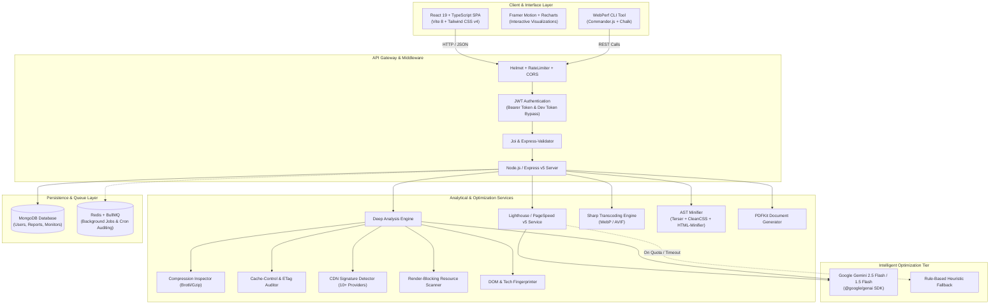

# WebPerfAI: Autonomous Web Performance & Core Web Vitals Optimization Engine

<div align="center">

[](LICENSE)
[](frontend/)
[](backend/)
[](backend/src/models/)
[](backend/src/utils/aiOptimizer.ts)
[](backend/src/services/lighthouseService.ts)
[](cli/)

**An enterprise-grade, full-stack performance intelligence suite, automated code/asset refactoring pipeline, and AI-driven diagnostic engine for modern web applications.**

*Google Core Web Vitals Auditing · Multi-Layer Deep Protocol Inspection (Brotli/Gzip/HTTP Cache/CDN) · Sharp AVIF/WebP Compression · AST-Level Code Minification · Gemini LLM Remediation Synthesizer · Interactive Network Waterfall · Headless CI/CD CLI*

[Executive Summary](#-executive-summary) • [Core Web Vitals Science](#-core-web-vitals--performance-metrics-science) • [Architecture](#-system-architecture) • [Feature Matrix](#-key-features--capabilities) • [Deep Inspection Pipeline](#-deep-inspection-pipeline-mechanics) • [API Reference](#-rest-api-specification) • [CLI Companion](#-headless-cicd-cli-companion) • [Quick Start](#-quick-start--installation)

</div>

---

## 📌 Executive Summary

Modern web applications lose up to **7% in conversions for every 100ms of latency**, while Google's search indexing algorithms directly penalize poor Core Web Vitals. Despite this, developers and DevOps engineers struggle with fragmented diagnostic tools: Chrome DevTools provides raw numbers without remediation code, standard Lighthouse audits generate non-contextual suggestions, and manual asset optimization remains tedious and error-prone.

**WebPerfAI (OptiWeb AI v2.0.0)** unifies diagnostics, automated remediation, asset compression, and artificial intelligence into a cohesive, high-performance platform:

1. **Precision Telemetry**: Extracts Lighthouse metrics (LCP, FCP, CLS, TTFB, TBT, Speed Index) and full HTTP network request waterfalls via the Google PageSpeed Insights REST API v5, with seamless offline mock fallbacks.
2. **Deep Protocol Audits**: Evaluates server-side Brotli/Gzip compression ratios, analyzes HTTP caching headers (`Cache-Control`, `ETags`, `Vary`, `Age`), fingerprints edge CDN deployments (Cloudflare, Fastly, CloudFront, Akamai, etc.), and isolates render-blocking CSS/JS assets.
3. **Automated Laboratory**: Inlines image transcoding via **Sharp** (converting PNG/JPEG to next-gen AVIF/WebP with configurable compression levels and geometry resizing) and AST-level code minification (**Terser**, **Clean-CSS Level 2**, and **HTML-Minifier-Terser**).
4. **Dual AI Optimization Engine**: Couples a deterministic heuristic prioritizing algorithm with **Google Gemini 2.5 Flash / 1.5 Flash** to synthesize actionable, copy-paste remediation code snippets and predicted Lighthouse score gains.
5. **Enterprise Delivery**: Exports executive-ready, multi-page branded PDF reports generated directly on the server canvas via **PDFKit**, complete with chronological audit history and A/B competitor benchmarking.

---

## 🎯 Core Web Vitals & Performance Metrics Science

WebPerfAI evaluates websites against Google's standardized User Experience (UX) benchmarks, providing programmatic thresholds and targeted recommendations:

```
               EXCELLENT (GOOD)           NEEDS IMPROVEMENT               POOR
Core Metric   [====================][========================][=========================>
LCP           0s                 2.5s                       4.0s
FCP           0s                 1.8s                       3.0s
CLS           0.00               0.10                       0.25
TTFB          0ms                800ms                     1800ms
TBT           0ms                200ms                      600ms
Speed Index   0s                 3.4s                       5.8s
```

### Quantitative Metrics Reference

| Metric | Full Designation | Target Threshold | Impact on End-User Experience | Primary Degradation Vectors |
| :--- | :--- | :--- | :--- | :--- |
| **LCP** | Largest Contentful Paint | $\le 2.5\text{ s}$ | Measures perceived load speed by logging when the main content block has rendered. | Unoptimized hero images, slow TTFB, client-side rendering bottlenecks. |
| **FCP** | First Contentful Paint | $\le 1.8\text{ s}$ | Marks the exact moment the browser renders any text, image, or non-white canvas element. | Synchronous render-blocking CSS/JS, high DNS lookup and TCP handshake latency. |
| **CLS** | Cumulative Layout Shift | $\le 0.10$ | Quantifies visual stability by measuring unexpected layout shifts during the viewport lifecycle. | Images/embeds lacking explicit `width`/`height` dimensions, dynamic ad injection, FOIT/FOUT fonts. |
| **TTFB** | Time to First Byte | $\le 800\text{ ms}$ | Measures server processing responsiveness and network transmission time for initial HTML byte. | Slow database queries, lack of server reverse proxy caching, geographic server distance. |
| **TBT** | Total Blocking Time | $\le 200\text{ ms}$ | Quantifies main-thread interactivity by measuring total time blocked by tasks exceeding $50\text{ms}$. | Heavy JavaScript parsing/compilation, bloated third-party trackers, un-chunked loops. |
| **SI** | Speed Index | $\le 3.4\text{ s}$ | Measures visual progression rate during page loading based on perceptual frame capture. | Render-blocking resources, inefficient critical CSS loading, unoptimized fonts. |

### Mathematical Formulas

#### Cumulative Layout Shift Calculation
$$\text{CLS} = \sum (\text{Impact Fraction} \times \text{Distance Fraction})$$

#### Payload Compression Ratio
$$\text{Compression Savings} = \left(\frac{S_{\text{uncompressed}} - S_{\text{compressed}}}{S_{\text{uncompressed}}}\right) \times 100\%$$

#### Overall Deep Analysis Category Score
$$\text{Score}_{\text{composite}} = \sum_{i=1}^{k} \left( w_i \times s_i \right) \quad \text{where} \quad \sum_{i=1}^{k} w_i = 1.0$$
*Default weights: Compression ($0.20$), Caching ($0.20$), CDN ($0.20$), Render-Blocking ($0.20$), Resource Efficiency ($0.20$).*

---

## 🏗️ System Architecture

WebPerfAI operates as an asynchronous, decoupled multi-tier system engineered with React 19, Express v5, MongoDB, Redis/BullMQ, and Gemini AI.



---

## 🔐 JWT Authentication & Security Workflow

WebPerfAI implements stateless JSON Web Token (JWT) authorization backed by Bcrypt password hashing and granular middleware protection.

```mermaid
sequenceDiagram
    autonumber
    actor User as Client / CLI
    participant Auth as Auth Controller (/api/auth)
    participant DB as MongoDB (Users Collection)
    participant Middleware as Auth Middleware
    participant Controller as Protected Controller

    User->>Auth: POST /register (name, email, password)
    Auth->>Auth: Generate Salt & Hash Password (bcryptjs)
    Auth->>DB: Save User Document
    Auth-->>User: 201 Created (User Registered)

    User->>Auth: POST /login (email, password)
    Auth->>DB: Query User by Email
    Auth->>Auth: Compare Hash (bcrypt.compare)
    Auth->>Auth: Sign JWT Token (HS256, 7-day expiration)
    Auth-->>User: 200 OK { token, user: { id, email, name } }

    Note over User,Middleware: Subsequent Protected Requests
    User->>Middleware: GET /api/analysis/history (Header: Bearer <token>)
    alt Valid JWT or Dev Token
        Middleware->>Middleware: jwt.verify(token, JWT_SECRET)
        Middleware->>Controller: req.user = decoded; next()
        Controller->>DB: Fetch Reports for userId
        Controller-->>User: 200 OK [ Reports Array ]
    else Invalid / Expired Token
        Middleware-->>User: 401 Unauthorized { message: "Token is not valid" }
    end
```

---

## ⚡ Key Features & Capabilities

### 1. 📊 AI Performance Dashboard
* **Instant Core Web Vitals Extraction**: Real-time auditing via Google PageSpeed Insights REST API with desktop/mobile emulation.
* **Predicted Score Modeling**: Dynamically calculates the anticipated post-optimization Lighthouse score by summing individual remediation impact gains:
  $$\text{Predicted Score} = \min\left(100, \text{Score}_{\text{current}} + \sum \Delta \text{Score}_{\text{predicted}}\right)$$
* **Interactive Network Waterfall**: Chronological Gantt chart plotting every network request with resource classification badges (Document, Script, Stylesheet, Image, Font) and millimeter-precise timing breakdowns.

### 2. 🛡️ Deep Protocol & Infrastructure Auditing
* **Brotli & Gzip Verification**: Transmits raw HTTP requests with custom `Accept-Encoding: br` and `gzip` headers, decompressing payloads to verify active server compression and compute transfer ratio gains.
* **HTTP Cache Policy Auditing**: Inspects `Cache-Control` directives (`max-age`, `s-maxage`, `immutable`, `stale-while-revalidate`), verifies `ETag` presence for HTTP 304 validation, and checks edge CDN cache hits (`cf-cache-status`, `x-cache`).
* **Edge CDN Detection**: Signature-matching engine recognizing 10+ major CDN architectures:
  * *Cloudflare, Fastly, Amazon CloudFront, Akamai, Google Cloud CDN, Vercel, Netlify, Microsoft Azure CDN, Bunny CDN, and KeyCDN*.
* **Render-Blocking Resource Detection**: RegEx AST scanner isolating un-deferred `<script>` tags and synchronous `<link rel="stylesheet">` tags, calculating total estimated blocking time in milliseconds.

### 3. 🔬 Feature Extraction & Technology Fingerprinting
* Scrapes and analyzes HTML `<head>` tags to audit SEO essentials: `<title>`, `<meta description>`, OpenGraph, canonical links, charset, and lang attributes.
* Detects active frameworks and libraries: **React, Next.js, Vue, Nuxt, Angular, jQuery, Bootstrap**.
* Scans third-party external origins to calculate DNS lookup overhead and connection degradation.
* Audits mobile readiness (viewport meta, Web App Manifest) and accessibility hygiene (missing image `alt` attributes, ARIA landmarks).

### 4. 🗜️ Smart Image Optimizer
* High-speed native image transcoding powered by **Sharp (libvips)**.
* Supports **AVIF, WebP, PNG, and JPEG** output formats with configurable compression effort and quality parameters ($1\text{--}100$).
* Geometry containment resizing (`fit: 'inside'`) to prevent layout shifts and eliminate oversizing.
* Reports exact byte savings and percentage size reduction.

### 5. 💻 Code Laboratory (AST Refactoring)
* **JavaScript**: Minified using `terser` with 2-pass dead code elimination, variable mangling, and console/debugger stripping.
* **CSS**: Cleaned using `clean-css` (Level 2 advanced optimization) including adjacent rule merging, shorthand conversion, media query merging, and duplicate selector deduplication.
* **HTML**: Compressed using `html-minifier-terser` with whitespace collapse, comment removal, and embedded script/style minification.

### 6. 📄 Automated Executive PDF Reports
* Built-in vector graphics reporting powered by **PDFKit**.
* Produces multi-page dark-themed executive dossiers with custom color-coded score gauges, metric tables, category breakdowns, and prioritized remediation matrices.

### 7. ⚖️ Competitive A/B Benchmarking
* Side-by-side performance comparison of two distinct URLs.
* Calculates differential delta scores:
  $$\Delta \text{Score} = \text{Score}_1 - \text{Score}_2, \quad \Delta \text{LCP} = \text{LCP}_1 - \text{LCP}_2, \quad \Delta \text{TTFB} = \text{TTFB}_1 - \text{TTFB}_2$$
* Declares a clear winner based on aggregated Core Web Vitals health.

### 8. 🧠 Gemini Research Desk
* Interactive research interface powered by **Google Gemini 2.5 Flash** (`@google/genai`).
* Delivers expert engineering briefings covering HTTP/3, QUIC, Speculative Loading, Edge Compute, Critical CSS extraction, and modern caching strategies.

---

## 🛠️ Technology Stack

| Layer | Technology | Version | Purpose |
| :--- | :--- | :--- | :--- |
| **Frontend Framework** | React.js | `v19.2.5` | Reactive Component UI Architecture |
| **Language (Frontend)** | TypeScript | `v6.0.2` | Type Safety & Model Synchronization |
| **Build Tool** | Vite | `v8.0.10` | Instant HMR & Production Bundling |
| **Styling** | Tailwind CSS v4 | `v4.2.4` | High-Performance Utility-First CSS |
| **Motion & Animation** | Framer Motion | `v12.38.0` | Fluid Transitions & Micro-Interactions |
| **Charts & Metrics** | Recharts | `v3.8.1` | SVG/Canvas Performance Visualization |
| **Icons** | Lucide React | `v1.11.0` | Consistent UI Iconography |
| **Backend Runtime** | Node.js | `v18+` | Server-Side Execution Environment |
| **API Framework** | Express | `v5.2.1` | RESTful Microservices & Routing |
| **Language (Backend)**| TypeScript | `v6.0.3` | Server-Side Strong Typing |
| **Database** | MongoDB | `v7.0+` | Audit Reports, User Profiles, Monitors |
| **ODM** | Mongoose | `v9.5.0` | Schema Enforcement & Query Modeling |
| **Background Queues** | BullMQ + Redis | `v5.76.1` / `v5.10.1` | Asynchronous Job Worker Architecture |
| **Task Scheduler** | Node-Cron | `v4.2.1` | Recurring Synthetic Performance Audits |
| **AI Synthesis** | Google Gemini | `v1.50.1` (`@google/genai`) | LLM Remediation & Performance Advisory |
| **Image Engine** | Sharp | `v0.34.5` | Ultra-Fast libvips Image Transcoding |
| **Minification** | Terser / Clean-CSS | `v5.46.2` / `v5.3.3` | AST-Level JavaScript and CSS Minification |
| **PDF Engine** | PDFKit | `v0.18.0` | Server-Side Vector PDF Dossier Rendering |
| **Security** | Helmet & Rate Limit | `v8.1.0` / `v8.4.1` | HTTP Header Security & Brute-Force Shield |
| **Authentication** | JWT & BcryptJS | `v9.0.3` / `v3.0.3` | Stateless Token Security & Pass Salt-Hashing|
| **Logging** | Winston & Morgan | `v3.19.0` / `v1.10.1` | Structured JSON Logs with Daily Rotation |

---

## 📋 Deep Inspection Pipeline Mechanics

```
Target URL ───────► [HTTP Handshake & Header Probing]
                          │
                          ├─► [Brotli/Gzip Test] ─────────► Compression Score (0-100)
                          │   (Header: Accept-Encoding: br)
                          │
                          ├─► [Cache Headers Audit] ──────► Caching Score (0-100)
                          │   (Cache-Control, ETag, Age)
                          │
                          ├─► [CDN Signature Match] ──────► CDN Score (0-100)
                          │   (10+ Vendor Signatures)
                          │
                          ├─► [DOM & RegEx AST] ──────────► Render-Blocking Score (0-100)
                          │   (Blocking <script>, <style>)
                          │
                          └─► [Feature Extraction] ───────► Resource Efficiency (0-100)
                              (Tech stack, SEO, Third-party)
                                       │
                                       ▼
                       [Composite Weighting Engine]
                                       │
                        Score = ∑ (Weight_i * Score_i)
                                       │
                                       ▼
                   [Prioritized Action Matrix Generation]
```

---

## 📡 REST API Specification

### Authentication Routes (`/api/auth`)

| Method | Endpoint | Access | Request Body | Response Payload | Description |
| :--- | :--- | :--- | :--- | :--- | :--- |
| `POST` | `/api/auth/register` | Public | `{ name, email, password }` | `{ message, token, user }` | Registers a new user and issues a JWT token. |
| `POST` | `/api/auth/login` | Public | `{ email, password }` | `{ message, token, user }` | Authenticates credentials and returns a JWT token. |

### Analysis Routes (`/api/analysis`)

| Method | Endpoint | Access | Request Body | Description |
| :--- | :--- | :--- | :--- | :--- |
| `POST` | `/api/analysis/analyze` | Protected | `{ url: string }` | Executes complete PageSpeed audit, calculates CWV, generates AI recommendations, stores report in MongoDB. |
| `POST` | `/api/analysis/compare` | Protected | `{ url1: string, url2: string }` | Performs dual-site audit and calculates relative differential performance metrics. |
| `GET` | `/api/analysis/history` | Protected | *None* | Retrieves chronological list of historical reports for the authenticated user. |
| `GET` | `/api/analysis/report/:id`| Protected | *Param: id* | Retrieves full details of a specific saved performance audit report. |

### Deep Diagnostics Routes (`/api/deep`)

| Method | Endpoint | Access | Request Body | Output / Description |
| :--- | :--- | :--- | :--- | :--- |
| `POST` | `/api/deep/full` | Protected | `{ url: string }` | Executes all deep analyzers (Compression, Cache, CDN, Render-blocking, Features) and returns overall score + prioritized actions. |
| `POST` | `/api/deep/compression` | Protected | `{ url: string }` | Audits Brotli and Gzip support, payload sizes, and compression ratios. |
| `POST` | `/api/deep/caching` | Protected | `{ url: string }` | Evaluates HTTP caching headers, expiration dates, and ETag revalidation. |
| `POST` | `/api/deep/cdn` | Protected | `{ url: string }` | Fingerprints edge CDN provider and verifies edge cache hit headers. |
| `POST` | `/api/deep/render-blocking`| Protected | `{ url: string }` | Scans for synchronous scripts and non-critical stylesheets blocking paint. |
| `POST` | `/api/deep/features` | Protected | `{ url: string }` | Extracts meta tags, detected technologies, accessibility, and third-party origins. |
| `POST` | `/api/deep/report/pdf` | Protected | `{ url: string }` | Generates and streams an executive-ready, multi-page vector PDF report. |

### Optimization Laboratory (`/api/optimize`)

| Method | Endpoint | Access | Content-Type | Parameters | Description |
| :--- | :--- | :--- | :--- | :--- | :--- |
| `POST` | `/api/optimize/image` | Protected | `multipart/form-data` | `image` (file), `format` (webp/avif), `quality` (1-100), `width`, `height` | Transcodes and resizes images via Sharp; returns byte savings and filename. |
| `GET` | `/api/optimize/download/:filename` | Public | *None* | Path parameter: `filename` | Securely downloads an optimized image asset from the server repository. |
| `POST` | `/api/optimize/code` | Protected | `application/json` | `{ code: string, type: 'javascript'\|'css'\|'html' }` | Minifies code using Terser, Clean-CSS, or HTML-Minifier-Terser. |

### Research Desk (`/api/research`)

| Method | Endpoint | Access | Request Body | Description |
| :--- | :--- | :--- | :--- | :--- |
| `POST` | `/api/research/query` | Protected | `{ query: string }` | Queries Google Gemini for expert analysis on web performance protocols, benchmarks, and actionable developer next steps. |

### System Health (`/api/health`)

| Method | Endpoint | Access | Response Payload | Description |
| :--- | :--- | :--- | :--- | :--- |
| `GET` | `/api/health` | Public | `{ status: "ok", version: "2.0.0", uptime, dbConnected }` | Reports server operational health, uptime, and database connection state. |

---

## 💻 Headless CI/CD CLI Companion

WebPerfAI includes a standalone Node.js command-line interface located in `cli/`, enabling automated performance threshold gates inside GitHub Actions, GitLab CI, or terminal workflows.

```bash
# Navigate to the CLI directory
cd cli

# Run basic performance analysis
node index.js https://example.com

# Run deep performance inspection via local API
node index.js https://example.com --deep

# Output raw JSON for pipeline piping
node index.js https://example.com --json | jq .
```

### CLI Output Preview

```text
🚀 Analyzing https://example.com...
Deep analysis requires a SaaS API token in production. Attempting local API...

Deep Analysis Complete!
-------------------
Overall Score: 92
Summary: Excellent optimization level. Minor tweaks recommended.

Top Priorities:
- [high] Defer/async 2 render-blocking scripts
- [medium] Upgrade from Gzip to Brotli for better compression
- [low] Enable ETag headers for conditional caching
-------------------
```

---

## 🖼️ User Interface Showcase

<div align="center">

| View | Description |
| :---: | :--- |
| **Performance Dashboard** | Real-time Core Web Vitals gauges, score visualization, metric breakdowns, and interactive network waterfall chart. |
| **Deep Analysis Suite** | Multi-category score breakdown (Compression, Caching, CDN, Render Blocking, Resource Efficiency) with prioritized action cards. |
| **Code Laboratory** | Live AST-based code minification for JS, CSS, and HTML with instantaneous byte-savings telemetry. |
| **Smart Image Optimizer** | Drag-and-drop image transcode pipeline to modern AVIF/WebP with real-time compression ratios. |
| **Gemini Research Desk** | AI conversational intelligence for web performance best practices, HTTP/3, and modern web standards. |
| **A/B Benchmark Matrix** | Direct head-to-head performance comparisons with differential metric delta indicators. |

</div>

---

## 🚀 Quick Start & Installation

### Prerequisites

* **Node.js**: `v18.0.0` or higher
* **npm**: `v9.0.0` or higher
* **MongoDB**: Local daemon running at `mongodb://127.0.0.1:27017` or MongoDB Atlas URI
* **Google PageSpeed API Key** *(Optional: mocks data automatically if omitted)*
* **Gemini API Key** *(Optional: utilizes rule-based heuristic fallbacks if omitted)*

### 1. Repository Clone

```bash
git clone https://github.com/SparkSidd/WebPerfAI.git
cd WebPerfAI
```

### 2. Backend Setup

```bash
cd backend
npm install
```

Configure your environment variables in `backend/.env`:

```env
PORT=5000
MONGODB_URI=mongodb://127.0.0.1:27017/web-perf-optimizer
JWT_SECRET=supersecret123_change_me_in_production
PAGESPEED_API_KEY=your_google_pagespeed_api_key_here
GEMINI_API_KEY=your_google_gemini_api_key_here
```

Start the backend API in development mode:

```bash
npm run dev
# Server will initialize on http://localhost:5000
```

### 3. Frontend Setup

Open a new terminal session:

```bash
cd frontend
npm install
npm run dev
# Frontend interface available at http://localhost:5173
```

### 4. CLI Setup *(Optional)*

```bash
cd cli
npm install
node index.js https://github.com
```

---

## 🧪 Verification & Health Check

Verify backend operation using curl or any REST client:

```bash
# Verify API Health and DB Connection
curl -s http://localhost:5000/api/health | jq .

# Output:
# {
#   "status": "ok",
#   "version": "2.0.0",
#   "uptime": 124.5,
#   "timestamp": "2026-11-13T03:30:00.000Z",
#   "dbConnected": true
# }
```

---

## 📂 Project Structure

```text
WebPerfAI/
├── backend/
│   ├── src/
│   │   ├── controllers/
│   │   │   ├── analysisController.ts       # PSI Auditing, Compare & History
│   │   │   ├── authController.ts           # JWT Registration & Authentication
│   │   │   ├── deepAnalysisController.ts   # Deep protocol audits & PDF rendering
│   │   │   ├── optimizationController.ts   # Sharp images & AST code minification
│   │   │   └── researchController.ts       # Gemini LLM research query handler
│   │   ├── middleware/
│   │   │   ├── authMiddleware.ts           # Bearer JWT verification & dev-bypass
│   │   │   ├── errorMiddleware.ts          # Centralized error handler
│   │   │   └── validationMiddleware.ts     # Joi & Express-Validator rules
│   │   ├── models/
│   │   │   ├── Monitor.ts                  # Scheduled synthetic audit schemas
│   │   │   ├── Report.ts                   # Core Web Vitals audit reports
│   │   │   └── User.ts                     # User accounts & salt-hashed auth
│   │   ├── routes/
│   │   │   ├── analysisRoutes.ts           # /api/analysis endpoints
│   │   │   ├── authRoutes.ts               # /api/auth endpoints
│   │   │   ├── deepAnalysisRoutes.ts       # /api/deep endpoints
│   │   │   ├── optimizationRoutes.ts       # /api/optimize endpoints
│   │   │   └── researchRoutes.ts           # /api/research endpoints
│   │   ├── services/
│   │   │   ├── cachingService.ts           # Cache-Control & ETag header auditor
│   │   │   ├── cdnService.ts               # 10+ CDN edge regex detector
│   │   │   ├── compressionService.ts       # Brotli/Gzip wire analysis
│   │   │   ├── featureExtractionService.ts # DOM, tech & metadata fingerprinter
│   │   │   ├── lighthouseService.ts        # Google PageSpeed v5 integration
│   │   │   ├── optimizationAlgorithm.ts    # Weighted scoring & prioritization
│   │   │   ├── pdfService.ts               # PDFKit multi-page report generator
│   │   │   └── renderBlockingService.ts    # Render-blocking CSS/JS analyzer
│   │   ├── utils/
│   │   │   ├── aiOptimizer.ts              # Google Gemini 2.5/1.5 Flash caller
│   │   │   └── logger.ts                   # Winston structured logger
│   │   └── index.ts                        # Express server entry point
│   ├── package.json
│   └── tsconfig.json
│
├── frontend/
│   ├── src/
│   │   ├── assets/                         # SVG & brand assets
│   │   ├── components/
│   │   │   ├── Sidebar.tsx                 # SaaS navigation with active state
│   │   │   └── WaterfallChart.tsx          # Network request visualizer
│   │   ├── pages/
│   │   │   ├── CodeOptimizer.tsx           # AST JavaScript/CSS/HTML minifier
│   │   │   ├── Comparison.tsx              # A/B competitor benchmarking
│   │   │   ├── Dashboard.tsx               # Main Core Web Vitals dashboard
│   │   │   ├── DeepAnalysis.tsx            # Deep audit suite with PDF export
│   │   │   ├── ImageOptimizer.tsx          # Sharp WebP/AVIF converter
│   │   │   ├── Login.tsx                   # JWT authentication portal
│   │   │   ├── Reports.tsx                 # Historical audit repository
│   │   │   └── Research.tsx                # Gemini-powered performance desk
│   │   ├── App.tsx                         # Client-side router configuration
│   │   ├── main.tsx                        # React application bootstrap
│   │   └── index.css                       # Tailwind CSS v4 styling rules
│   ├── package.json
│   └── vite.config.ts
│
├── cli/
│   ├── index.js                            # Headless CLI implementation
│   └── package.json
│
└── README.md                               # Canonical project documentation
```

---

## 📜 License

This project is licensed under the **MIT License** — see the [LICENSE](LICENSE) file for full details.

---

<div align="center">

Crafted with ⚡ and precision by [SparkSidd](https://github.com/SparkSidd).  
*Advancing web performance through intelligent diagnostics and automated engineering.*

</div>
